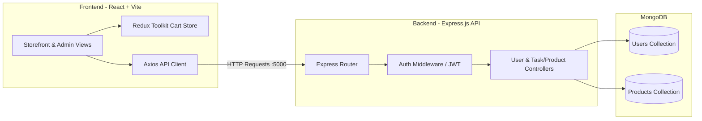

# 🛒 Pullo Shoes — Full-Stack MERN E-Commerce & Admin Platform

[](https://react.dev/)
[](https://vitejs.dev/)
[](https://nodejs.org/)
[](https://www.mongodb.com/)
[](https://redux-toolkit.js.org/)

A full-featured MERN stack e-commerce web application featuring an interactive storefront, Redux-powered shopping cart, user authentication, and a dedicated administrative dashboard for managing products and registered users.

---

## 📌 Table of Contents

- [Overview](#overview)
- [Key Features](#key-features)
  - [Customer / Storefront](#customer--storefront)
  - [Admin Dashboard](#admin-dashboard)
- [Tech Stack](#tech-stack)
- [Project Architecture](#project-architecture)
- [Directory Structure](#directory-structure)
- [Getting Started](#getting-started)
  - [Prerequisites](#prerequisites)
  - [1. Backend Setup](#1-backend-setup)
  - [2. Frontend Setup](#2-frontend-setup)
- [Environment Variables](#environment-variables)
- [API Endpoints](#api-endpoints)
- [How to Upload this Project to GitHub](#how-to-upload-this-project-to-github)
- [License](#license)

---

## 📖 Overview

**Pullo Shoes** is a full-stack shopping and product catalog management application. It consists of:
1. **Frontend (`Ecom/Ecom`)**: Built with **React 18** and **Vite** for fast performance, utilizing **Redux Toolkit** for centralized shopping cart state management, and **React Router DOM** for routing between public store views and the admin panel.
2. **Backend (`nodejs_todoapp-master`)**: An **Express.js & Node.js** REST API connected to **MongoDB** via Mongoose, providing endpoints for authentication (JWT & bcrypt), product CRUD operations, and user management.

---

## ✨ Key Features

### Customer / Storefront
- **Modern Homepage & Showcase**: Responsive hero section and promotional banners.
- **Product Catalog (`/shop`)**: Browse items dynamically fetched from MongoDB with live search and keyword filtering.
- **Redux-Powered Shopping Cart (`/cart`)**:
  - Add items to cart with user-specific isolation.
  - Increment/decrement item quantity and live price recalculation.
  - Remove items from cart.
  - Checkout process with cart clearance and feedback toasts.
- **User Authentication (`/login`, `/register`)**:
  - Account registration with secure password hashing via `bcrypt`.
  - User login with cookie-based JWT session authentication.
  - Navigation bar displays active login state and logout option.
- **Company Pages**: About Us (`/about`) and Contact Us (`/contact`) pages.

### Admin Dashboard
- **Admin Authentication**: Secure administrative login routing directly to the management portal.
- **Product Management (`/admin/insert`, `/admin/vprod`)**:
  - Add new products with title, price, description, category, and direct image upload (Base64 encoded).
  - View all live catalog products in a styled data table.
  - In-place editing and updating of product details.
  - Delete obsolete products from the database with confirmation.
- **User Management (`/admin/vuser`)**:
  - View all registered platform users.
  - Remove user records directly from the database.

---

## 🛠 Tech Stack

### Frontend
- **Framework / Bundler:** React 18, Vite
- **State Management:** Redux Toolkit (`@reduxjs/toolkit`), `react-redux`
- **Routing:** React Router DOM (v6)
- **HTTP Client:** Axios
- **Notifications:** React Hot Toast
- **Icons & Styling:** React Icons, Bootstrap, Custom CSS

### Backend
- **Runtime:** Node.js (ES Modules)
- **Web Framework:** Express.js
- **Database:** MongoDB with Mongoose ODM
- **Authentication & Security:** JSON Web Tokens (`jsonwebtoken`), `bcrypt`, `cookie-parser`, `cors`
- **Configuration & Utilities:** `dotenv`, `nodemon`

---

## 🏗 Project Architecture



---

## 📁 Directory Structure

```text
nodejs_todoapp-master/
├── .gitignore                      # Git ignore rules for node_modules, .env, build outputs
├── README.md                       # Main project documentation
├── feedback.json                   # Sample feedback record
├── Ecom/                           # Frontend root workspace
│   ├── package.json
│   └── Ecom/                       # Vite + React client application
│       ├── .env                    # Frontend environment variables
│       ├── index.html              # HTML entry point
│       ├── vite.config.js          # Vite configuration
│       ├── package.json            # Frontend dependencies & scripts
│       ├── public/                 # Static assets (images, css, icons)
│       └── src/
│           ├── main.jsx            # React root component & routing setup
│           ├── App.jsx             # App layout
│           ├── app/
│           │   └── Store1.js       # Redux store configuration
│           ├── features/
│           │   └── Cart2.js        # Cart slice & reducer actions
│           └── Components/         # React UI components
│               ├── Navbar.jsx      # Customer navigation bar
│               ├── AdminNavbar.jsx # Admin navigation bar
│               ├── Home.jsx        # Landing page
│               ├── Shop.jsx        # Product catalog with filter
│               ├── Cart1.jsx       # Shopping cart interface
│               ├── Login1.jsx      # Login (User & Admin)
│               ├── Register1.jsx   # Registration page
│               ├── InsertData.jsx  # Admin: Add new product
│               ├── ViewProducts.jsx# Admin: View/Edit/Delete products
│               ├── ViewUsers.jsx   # Admin: View & delete users
│               ├── AboutUs.jsx     # About Us view
│               └── ContactUs.jsx   # Contact Us view
│
└── nodejs_todoapp-master/          # Backend Node.js / Express API
    ├── server.js                   # Application server entry point (Port 5000)
    ├── app.js                      # Express middleware and route mounting
    ├── package.json                # Backend dependencies & scripts
    ├── data.json                   # Sample seed data
    ├── data/
    │   └── database.js             # Mongoose MongoDB connection
    ├── controllers/
    │   ├── user.js                 # Login, register, profile controllers
    │   └── task.js                 # Product CRUD and task controllers
    ├── middlewares/
    │   └── auth.js                 # JWT authentication middleware
    ├── models/
    │   ├── user.js                 # Mongoose User schema
    │   └── task.js                 # Mongoose Product, Category & Task schemas
    ├── routes/
    │   ├── user.js                 # User auth routes (/api/v1/users)
    │   └── task.js                 # Product & task routes (/api/v1/task)
    └── utils/
        └── features.js             # Cookie & token helper utilities
```

---

## 🚀 Getting Started

### Prerequisites

Ensure you have the following installed on your machine:
- **Node.js** (v16.x or newer recommended) — [Download Node.js](https://nodejs.org/)
- **MongoDB** (Local instance running at `mongodb://localhost:27017` or a MongoDB Atlas URI) — [Download MongoDB Community](https://www.mongodb.com/try/download/community)
- **Git** (for version control and uploading to GitHub) — [Download Git](https://git-scm.com/)

---

### 1. Backend Setup

1. Open your terminal and navigate to the backend directory:
   ```bash
   cd nodejs_todoapp-master/nodejs_todoapp-master
   ```

2. Install dependencies:
   ```bash
   npm install
   ```

3. Ensure MongoDB is running locally:
   ```bash
   # On Windows (Command Prompt or PowerShell with MongoDB service):
   net start MongoDB
   ```

4. Start the backend server in development mode:
   ```bash
   npm run dev
   ```
   > The API server will start on **`http://localhost:5000`**.

---

### 2. Frontend Setup

1. Open a new terminal window and navigate to the React client directory:
   ```bash
   cd Ecom/Ecom
   ```

2. Install dependencies:
   ```bash
   npm install
   ```

3. Start the Vite development server:
   ```bash
   npm run dev
   ```
   > The client will be available at **`http://localhost:5173`** (or the URL displayed in the terminal).

---

## 🔐 Credentials & Default Admin Access

- **Admin Login:** Navigate to `/login` and use:
  - **Username:** `dev`
  - **Password:** `dev123`
  *(Once authenticated as admin, you are redirected to `/admin/insert` to manage items and users).*

---

## 📡 API Endpoints

### User Routes (`/api/v1/users`)
| Method | Endpoint | Description |
|---|---|---|
| `POST` | `/new` | Register a new user |
| `POST` | `/login` | Authenticate user & receive cookie |
| `GET` | `/logout` | Log out user & clear auth cookie |
| `GET` | `/me` | Fetch currently authenticated user profile |

### Product & Admin Routes (`/api/v1/task`)
| Method | Endpoint | Description |
|---|---|---|
| `GET` | `/data1` | Retrieve all products for the shop & admin |
| `POST` | `/upload-data` | Create a new product (supports Base64 image) |
| `PUT` | `/products/:id` | Update product details by ID |
| `DELETE` | `/products` | Delete product by ID |
| `GET` | `/userdata` | Retrieve all registered users |
| `POST` | `/userid` | Delete a user by ID |

---

## 📤 How to Upload this Project to GitHub

Follow these steps to upload this project to your GitHub account:

### Step 1: Create a new repository on GitHub
1. Log in to [GitHub](https://github.com/).
2. In the top-right corner, click the **`+`** icon and select **New repository**.
3. Name your repository (e.g. `pullo-shoes-ecommerce` or `mern-ecommerce-store`).
4. Choose **Public** or **Private**.
5. **Do NOT** check "Add a README file", ".gitignore", or "license" (we already created them).
6. Click **Create repository**.

---

### Step 2: Initialize Git in your project root
Open a terminal in the root folder (`d:\Projects\nodejs_todoapp-master`) and execute:

```bash
# 1. Initialize a new Git repository
git init

# 2. Stage all project files (node_modules will be ignored automatically by .gitignore)
git add .

# 3. Create your first commit
git commit -m "Initial commit: Pullo Shoes full-stack MERN e-commerce application"

# 4. Set default branch to main
git branch -M main

# 5. Link your local project to your GitHub repository
# Replace YOUR_USERNAME and YOUR_REPO_NAME with your GitHub details
git remote add origin https://github.com/YOUR_USERNAME/YOUR_REPO_NAME.git

# 6. Push your project to GitHub
git push -u origin main
```

> **Note on Git installation:** If `git` is not recognized in your terminal, download and install [Git for Windows](https://git-scm.com/download/win), restart your terminal or VS Code, and re-run the commands above. Alternatively, you can use [GitHub Desktop](https://desktop.github.com/) to publish the folder with a click.

---

## 📄 License

This project is licensed under the [ISC License](LICENSE). Feel free to customize and extend it for your own personal or educational projects!
